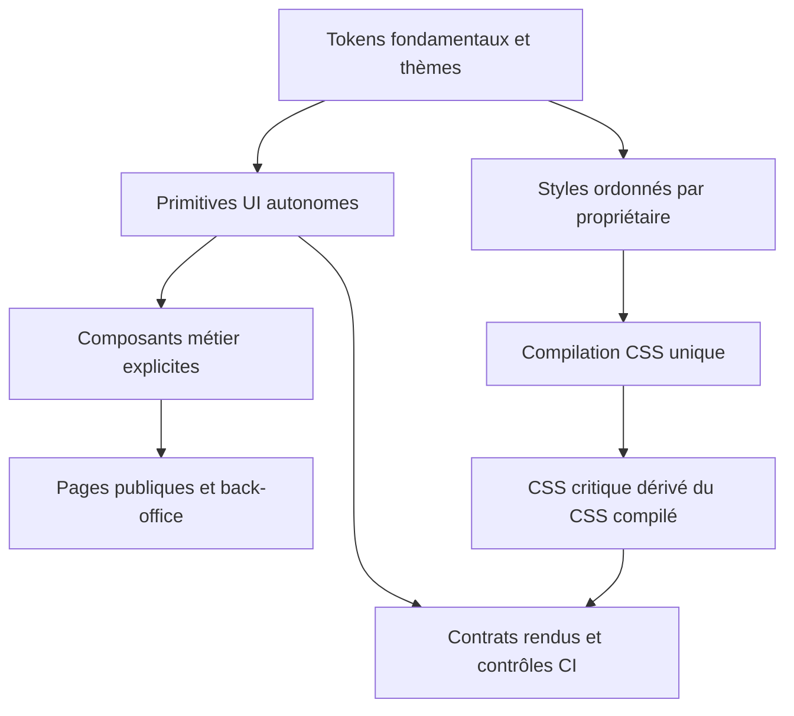

# Remise à plat structurelle du design system ToolTrim

Statut : proposition à valider, 27 octobre 2026. Diagnostic : `docs/DESIGN_SYSTEM_AUDIT.md`. Base inspectée : `ea96a20318`.

## Intention

Un nouveau chantier doit hériter automatiquement du système actif. Il ne doit plus demander au propriétaire de repréciser les boutons, les champs ou les surfaces, ni choisir arbitrairement une ancienne famille de styles encore présente. Le back-office est le premier parcours de migration, pas la frontière du problème.

Le demandeur délègue l'apparence de l'outil interne. Les choix techniques ci-dessous sont proposés par Codex ; ils ne sont pas présentés comme déjà approuvés. Les parcours publics conservent leur intention visuelle et leur comportement ; cette remise à plat n'est pas une nouvelle direction artistique du site.

## Approches considérées

| Approche | Effet | Limite |
| --- | --- | --- |
| Corriger la documentation et ranger le CSS | Réduit l'ambiguïté pour les prochains travaux | Les priorités historiques, contrôles locaux et dépendances métier restent exécutables. Insuffisant seul. |
| Réécrire d'un coup tous les écrans et le CSS | Supprime le passé en une seule bascule | Change simultanément compilation, milliers de pages publiques et parcours privés ; régression difficile à isoler. Non recommandée. |
| Remplacer le socle et migrer par parcours, avec suppression à chaque lot | Permet un système commun démontré dans l'application puis étendu jusqu'au retrait de la compatibilité | Plusieurs lots nécessaires ; chaque ancien consommateur doit être suivi jusqu'à suppression. Recommandée. |

Une période de migration est nécessaire ; son inventaire doit diminuer. Une couche legacy indéfinie ou un kit interne supplémentaire ne constitue pas l'état final accepté.

## Architecture cible

### Référence et propriété

- `AGENTS.md` conserve le workflow et les liens ; pas de seconde palette ni de règle visuelle recopiée.
- `docs/DESIGN_SYSTEM.md` ne contient que les conventions actives, les variantes métier intentionnelles et les liens vers leurs composants.
- `docs/ARCHITECTURE.md` décrit les routes, le shell et la compilation réellement utilisés.
- Les décisions historiques restent dans Git ou dans des documents explicitement historiques, hors du chemin de référence des nouveaux travaux.
- Un module commun de tokens et de thèmes possède les valeurs fondamentales. Les alias de migration sont inventoriés avec consommateurs et condition de retrait ; aucun alias arbitraire ne constitue une correction.

### Primitives autonomes

Point d'entrée neutre dans `src/components/ui` ; les composants Radix existants peuvent fournir les interactions accessibles, sans devenir une source visuelle implicite.

Contrats nécessaires : action `Button`, navigation `ButtonLink`/`TextLink`, `IconButton`, champ et label/aide/erreur, `Input`, `Select`, `Textarea`, `Surface`, `PageHeader`, `Toolbar`, navigation de sections et filtres. La séparation exacte des fichiers sera fixée dans le plan d'implémentation.

Chaque contrôle définit explicitement ses variantes pertinentes, tailles, états disabled/loading/selected/invalid, focus, cible tactile, icône, libellé long et comportement clavier. Une action, un lien, un onglet et un filtre ne sont pas interchangeables.

Le même composant conserve sa géométrie et ses états hors d'une page métier : aucun ancêtre `.ms-page`, `.ac-page` ou `.bo-shell` nécessaire. Les pages assemblent la disposition ; elles ne redéfinissent pas l'apparence de ses primitives. Les variantes publiques intentionnelles sont nommées et documentées, sans forcer une CTA marketing et une réponse de diagnostic à être identiques.

### Cascade et CSS critique

Décomposer les styles par fondation, primitives et propriétaire métier, avec une entrée centrale explicite. Consolider les différentes passes d'un composant avant de supprimer les blocs remplacés. Préserver les variantes de thème, breakpoint et état qui font partie du contrat.

Le CSS critique doit être extrait de l'AST compilé, dans son ordre original, en conservant les contextes nécessaires et les dépendances de tokens. Le premier affichage et la feuille complète doivent être cohérents. Le détail du mécanisme d'extraction est à trancher par le plan après tests des cas actuels ; pas de remplacement improvisé par un parseur de chaînes.

La cible est une cascade native ordonnée, sans `legacyCssCascade()`. Ne pas basculer globalement les couches avant que les consommateurs hors couche et les déclarations importantes aient été traités. Les cas initiaux et finaux ont des tests de sortie CSS et de rendu de production.

## Périmètre et ordre de migration

1. Figer les rendus et comportements publics de référence, inventorier les usages réels et reproduire les défauts de compilation. Nettoyer simultanément les autorités documentaires contradictoires.
2. Livrer le socle UI et la chaîne de styles vérifiable, avec une page de référence de développement/test exclue de l'indexation et des routes publiques de production.
3. Migrer entièrement connexion admin, vue d'ensemble, utilisateurs/détail, catalogue/édition/publication et diagnostic historique conservé. Retirer les imports StackKit, classes compte et ancêtre `ms-page` du back-office. Supprimer leurs anciens styles remplacés dans ce même lot.
4. Migrer comptes/auth puis recomposer Ma Stack sur les primitives neutres, en préservant ses cartes, dataviz et réponses métier.
5. Migrer shell et familles publiques actives, en conservant leurs variantes approuvées ; retirer les implémentations devenues inutilisées à chaque lot.
6. Retirer les alias/consommateurs de migration, les définitions mortes démontrées, l'extracteur critique historique et le plugin de compatibilité. Actualiser la référence active et les contrôles.

Les lots doivent être séparément reviewables et livrables. L'avancement du back-office seul ne permet pas de déclarer la remise à plat globale terminée.

## Garde-fous durables

- Contrôle de propriété des tokens : doubles définitions inconditionnelles interdites ; thèmes/breakpoints explicitement autorisés.
- Contrôle de dépendances des composants : les périmètres migrés ne peuvent importer un kit métier pour obtenir un contrôle générique.
- Contrôle AST des contournements JSX et CSS dans les périmètres migrés. Une simple liste d'import interdits ne suffit pas si les classes restent copiables.
- Exceptions exactes et bornées pour les consommateurs non migrés, au lieu de budgets agrégés qui permettent de nouvelles violations ailleurs. Les valeurs dynamiques utiles, notamment dataviz, ne sont pas interdites par principe.
- Contrôles du CSS produit : ordre, contexte, absence de redéfinition parasite des primitives ; absence de nouvelles règles hors couche ou de `!important` correctif dans les modules migrés.
- Tests réels sur build/preview de production, en complément du développement : premiers styles et styles complets, FR/EN, desktop/mobile, clavier, thèmes présents, mouvement réduit, états d'attente/erreur et libellés longs.

## Critères de fin

- Un développeur ajoute une action ou un formulaire par le point d'entrée commun, sans rechercher quelle ancienne famille copier.
- Le back-office ne dépend plus visuellement des kits Stack ou compte et utilise les primitives pour tous ses parcours maintenus.
- Aucun ancien bouton ne subsiste comme implémentation générique parallèle dans un périmètre déclaré migré.
- Les anciennes règles remplacées sont supprimées, et les exceptions restantes sont localisées, justifiées et attachées à un lot de retrait.
- Une réintroduction d'une ancienne famille ou une redéfinition de primitive par une page fait échouer un contrôle explicite.
- Les parcours publics de référence restent conformes aux rendus revus ; le build, le CSS critique et le navigateur racontent la même cascade.
- Le plugin de cascade historique est retiré avant de déclarer la remise à plat globale achevée.

## Exclusions et contraintes

Pas de migration de données, de changement d'authentification, de suppression de fonctions métier, ni de mise à jour factuelle du catalogue sous couvert de nettoyage. Ne pas supprimer des styles à partir d'une seule recherche textuelle ou d'une seule capture de couverture. Pas de nouvelle bibliothèque UI imposée pour contourner le travail de contrat. Le dark mode existant reste à préserver sur les parcours touchés ; le chantier n'ajoute pas une nouvelle ambition de produit pour ce thème.

## Validation attendue

Valider le périmètre architectural et l'ordre de migration. Il n'est pas demandé au propriétaire de redéfinir les rayons, couleurs ou boutons internes : ces choix relèvent du socle documenté et de l'implémentation. Après cette validation, produire le plan d'implémentation Superpowers avec fichiers, interfaces, tests et suppressions par lot, puis exécuter les lots avec revue et preuve de rendu.
