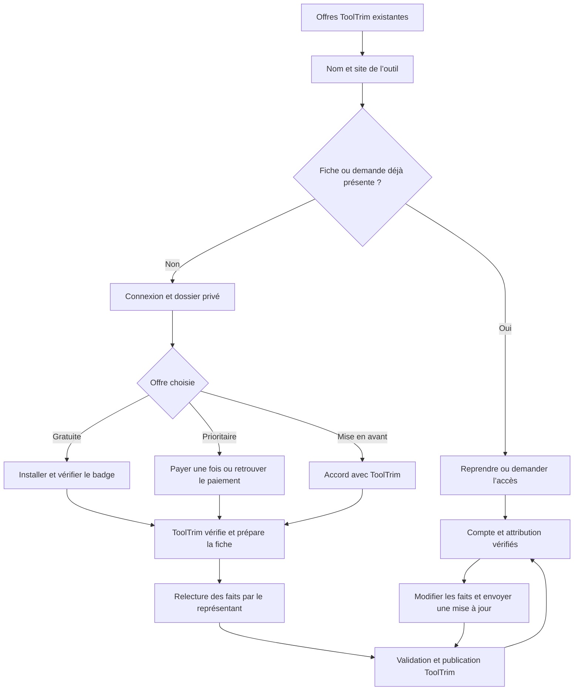
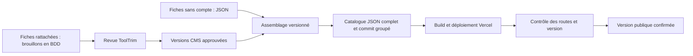

# CMS éditeurs ToolTrim — inscription, création, validation et vie de la fiche

Date : 16 novembre 2026. Auteur : Codex, cadrage Astra pour exécution Sol.
Statut : cadrage corrigé après décision de Michael sur le stockage, **aucune fonctionnalité CMS éditeur déployée par ce travail**.
Plan associé : [plan d’implémentation](../plans/2026-11-16-cms-editeurs.md).

## Contrainte prioritaire — correction de Michael du 16/11/2026

**Conserver Supabase Free. Seules les fiches rattachées à un compte éditeur sont gérées en BDD ; les autres restent dans le circuit JSON.** Le compte administrateur ne constitue pas un rattachement éditeur. Cette décision remplace la proposition antérieure de migration générale du catalogue.

- Un dossier initial créé par un compte peut conserver son brouillon privé en BDD. Une simple revendication ne migre pas la fiche publique : l’attribution doit être validée.
- Lors du rattachement validé d’une fiche existante, importer uniquement cette fiche et ses brouillons concernés, avec contrôle de la révision JSON. Elle garde son identifiant, son URL, ses contenus et son analyse ToolTrim.
- Un seul propriétaire d’écriture par fiche : JSON pour les fiches non rattachées, service CMS pour les fiches rattachées. Le JSON publié contient toujours tout le catalogue ; sa copie d’une fiche CMS est une projection, pas une deuxième source modifiable.
- Une publication assemble la révision Git des fiches JSON et les versions approuvées des fiches CMS. Le site, la recherche, Ma Stack et le sitemap utilisent le même résultat statique ; aucune lecture Supabase par visite publique.
- Les schémas, versions, brouillons et releases décrits ci-dessous sont limités au périmètre CMS. Ne pas enregistrer le catalogue complet dans chaque release DB : conserver les références Git, hashes et seuls éléments CMS concernés. Les références à un outil JSON ne doivent pas forcer son import ni une clé étrangère vers une ligne DB inexistante.
- Une révocation bloque l’accès immédiatement mais ne supprime ni la fiche ni ses versions. Le retour définitif au circuit JSON doit être une opération explicite, avec résolution des brouillons et sauvegarde vérifiée avant toute purge DB.
- Les données historiques déjà présentes dans Supabase nécessitent un inventaire et une décision de retrait distincte ; aucune suppression automatique ou migration générale dans ce chantier.
- Budget global du projet, pas seulement par éditeur : mesurer base, fichiers et transferts ; borner les uploads et la rétention. Aucun plan payant, transformation d’image payante ou nouveau projet pour contourner les quotas. Le traitement d’images doit rester compatible avec les services gratuits retenus.

La limite de 1 000 résultats par requête n’est pas une limite de lignes stockées. Les quotas publiés du plan Free incluent 500 Mo de base et 1 Go de fichiers : [tarifs Supabase](https://supabase.com/pricing), [pagination et résultats](https://supabase.com/docs/reference/javascript/v1/select). Leur respect doit être mesuré ; le cadrage ne prouve pas la capacité restante du projet.

## 1. Objectif et décisions

Une personne découvre l’offre ToolTrim, crée son compte, crée une demande de fiche ou retrouve un outil existant, remplit la condition de son offre (badge ou paiement), prépare les faits, suit la validation puis gère sa fiche publiée. Son travail est conservé en base. ToolTrim rédige et conserve son analyse indépendante et maîtrise la publication. Le périmètre comprend le parcours d’acquisition et de création, pas uniquement les personnes déjà invitées sur une fiche existante.

### Demandé par Michael

- Un compte personnel avec un accès dédié à l’édition de ses propres fiches.
- La fiche en base de données, avec de vrais téléversements de visuels.
- La partie factuelle modifiable : description, prix, informations produit. L’analyse et la notation appartiennent à ToolTrim.
- Une ergonomie de fiche/profil, des blocs qui ressemblent au rendu public, des actions à leur emplacement, pas de CMS technique à comprendre.
- Conserver Storybook et `src/ds/` en lecture seule ; composer les composants existants et signaler les manques.
- Cadrer maintenant pour transmettre l’implémentation à Sol. Ce document ne prétend pas que l’étape 1 est entièrement livrée.
- Correction explicite de Michael pendant le cadrage : reprendre les offres déjà en place, **gratuit avec badge / payant sans badge**, le paiement et la page de souscription existants. Revoir tout le système global d’inscription, de création de fiche et de validation.

### Choix proposés par Astra dans la latitude donnée

1. **Compte unique, espace éditeur dédié** : réutiliser Supabase Auth et le profil existant. La même personne peut utiliser Ma Stack et représenter un ou plusieurs outils ; aucun second mot de passe.
2. **Inscription ouverte, attribution contrôlée.** Un inscrit peut préparer sa propre demande de nouvelle fiche ; ToolTrim vérifie le représentant avant de lui attribuer une fiche publique. Invitation pour les représentants existants et récupération des anciennes souscriptions. Ni le domaine email ni le paiement ne donnent à eux seuls la propriété d’une fiche existante.
3. **Validation humaine avant publication.** L’éditeur envoie une proposition ; ToolTrim l’accepte ou demande des corrections. L’éditeur ne pousse jamais sur GitHub et ne publie pas seul. Ce choix peut évoluer sans changer le modèle de données.
4. **Stockage sélectif imposé par Michael.** Supabase gère uniquement les fiches rattachées à un compte éditeur ; les autres restent éditées via le circuit JSON. La publication assemble les deux périmètres dans un catalogue statique commun, sans deux writers pour une même fiche.
5. **Même éditeur de fiche pour les deux rôles**, avec des capacités calculées côté serveur. Pas une copie simplifiée du back-office qui divergera ensuite.
6. Première recette complète sur un nouveau dossier gratuit, un payant et une fiche existante, puis un canari de production autorisé. Plusieurs fiches/membres sont possibles ; gestion autonome d’équipe et nouveaux abonnements hors V1. **Les offres et paiements déjà vendus sont dans V1**, sans nouveau tarif ni nouvelle obligation d’achat.

Ces choix restent proposés sauf les contraintes explicitement demandées par Michael : offres existantes, parcours global, Supabase gratuit et stockage sélectif. Aucun paiement ne doit modifier le score, le classement organique ou les droits sur l’analyse par effet implicite. La mise en avant commerciale reste distincte et signalée comme telle.

## 2. État vérifié et aptitude à démarrer

Sources examinées le 16/11/2026 : code du commit de production `415800ebdfa3c1f729570c9f8e415a0dc0294660`, copie propre `/tmp/tooltrim-retire-audit.n5BZ5x`, travail local `/Users/mike/.codex/worktrees/backoffice-pilotage/New project`, introspection SQL en lecture seule du projet Supabase `rtfyfuwfdpnsogovkwai`.

| Élément | État constaté | Conséquence pour Sol |
|---|---|---|
| Site et back-office public | Vercel READY sur `415800e`, retrait Diagnostic. Réponse 200 du back-office et redirection 308 Diagnostic vers Ma Stack | Cela ne constitue pas une recette complète édition/publication |
| Brouillons administrateur | `api/_backoffice-catalog-store.ts` : Redis `tt:catalog-editor:v1` ; `api/backoffice-catalog.ts` : admin confirmé, publication JSON par GitHub | Migrer uniquement les brouillons des fiches rattachées ; conserver le circuit des autres. Ne pas exposer cette API admin aux éditeurs |
| Catalogue du build | 1 360 enregistrements/slugs dans `src/data/tools_v4.json` du commit publié ; `SB_SOURCE_DISABLED_WHILE_CODEX_RESTRUCTURES = true` dans `vite.config.ts` | Le JSON publié est une entrée obligatoire de la réconciliation |
| Catalogue Supabase | 1 178 lignes `public.tools`, dont 1 047 `published` ; 2 094 lignes FR/EN dans `catalog_api.published_tool_projection` | Les périmètres diffèrent. Les seuls décomptes ne permettent pas d’attribuer chaque écart |
| Canonique existant | `catalog_private` contient plans, observations de prix, localisations, médias, sources, versions éditoriales, relations, états de domaines, événements de publication | Réutiliser ces entités ; ne pas recréer une seconde base outils |
| Contributions existantes | `catalog_contrib.brands`, `brand_memberships`, `brand_tool_assignments`, `tool_change_requests`, `tool_change_request_items`, `tool_change_request_events` ; toutes vides lors du contrôle | Le modèle d’attribution existe déjà, le parcours applicatif reste à faire |
| Sécurité existante | RLS activée sur les six tables de contribution ; contrôles de transitions existants ; droits et politiques partiels | Ce socle n’est pas une preuve de sécurité du futur CMS. Compléter et tester les révocations, les champs, les transitions et les voies directes |
| Stockage | Un bucket `brand-assets`, public, PNG uniquement, 1 Mio | Ne pas y déposer les brouillons privés ; créer les espaces privés/publics du CMS |
| Offres commerciales | `/fr/submit` et `SubmitToolPage.tsx` : 0 $ avec badge, 29 $ une fois sans badge, mise en avant à partir de 99 $ sur contact | Conserver ces trois parcours et les droits déjà acquis ; aucun nouvel abonnement inventé |
| Paiement / badge | `verifySubmissionPayment` interroge Creem et vérifie checkout, mode prod, commande payée, produit et métadonnées de soumission/outil ; `verifyBadgeOnPage` vérifie domaine et badge lié ; `contact.ts` revérifie avant acceptation | Réutiliser les contrats. Ajouter le rattachement fiable au compte/outil et le suivi durable ; `paid=true` seul ne vaut rien |
| Reçus de soumission | Redis, idempotence par `submissionId` et `checkoutId`, jobs de notification séparés ; pas d’entitlement compte/outil dans le contrat actuel | Import/réconciliation des dossiers existants sans nouveau débit, sans supposer qu’un ancien email ou le localStorage prouve la propriété |
| Édition locale récente | `catalogAuthoring.ts` distingue produit/classement/analyse/interne mais dit explicitement ne pas donner de droits ; `CatalogMediaFields.tsx` utilise des URL, pas d’upload | Portage ciblé après revue de diff ; pas de merge global du chantier local |

**Oui pour lancer le chantier ; non pour ouvrir les comptes éditeur immédiatement.** Les premiers livrables doivent établir la parité des données et un circuit d’écriture unique. Attention à la configuration Git commune : une commande sans `--work-tree` résout ici `/Users/mike/Documents/New project` alors que le cwd est `retire-stack-audit`. Le contrôle avec `git --work-tree='/Users/mike/.codex/worktrees/retire-stack-audit/New project'` montre ce checkout propre avant les documents de cadrage ; ne jamais interpréter les différences de l’autre checkout comme le contenu à livrer. Les cinq fonctions Supabase Diagnostic encore actives sont une dette de retrait distincte ; ne pas les compter comme retirées ni les réutiliser dans le CMS.

### Approches étudiées

| Approche | Compromis | Décision |
|---|---|---|
| Étendre Redis/JSON avec un rôle éditeur | Rapide en apparence, mais droits imbriqués fragiles, médias et versions séparés, double vérité avec Supabase | Écartée : ne répond pas à la demande de CMS en base |
| Installer un CMS tiers et synchroniser | Interface disponible, mais nouveau modèle Auth, nouveau stockage et synchronisation de l’analyse et des prix canoniques | Écartée pour cette étape : recrée le problème de sources |
| Réutiliser Supabase et `catalog_contrib`, publier des versions figées vers le site | Migration initiale plus exigeante ; une identité, une autorisation, un contrat de rendu | Retenue par Astra |

## 3. Les offres, le compte et la création de fiche

### 3.1 Matrice commerciale existante à conserver

| Origine / offre | Condition | Promesse actuellement affichée | Effet CMS |
|---|---|---|---|
| Référencement éditorial existant | Fiche créée à l’initiative de ToolTrim, sans achat présumé | Ne pas transformer rétroactivement ces fiches en clients payants | Attribution manuelle au représentant vérifié ; corrections factuelles possibles sans nouveau paiement imposé |
| Revue standard, 0 $ | Badge ToolTrim lié installé sur le site soumis | Sélection éditoriale, environ 4–6 semaines, corrections factuelles après publication, lien annoncé nofollow | Dossier privé et statut de badge ; entrée en revue quand les prérequis sont remplis ; pas de publication automatique |
| Fiche prioritaire, 29 $ une fois | Paiement Creem confirmé côté serveur | Fiche FR/EN rédigée par ToolTrim, publication annoncée sous 5 jours ouvrés, faits vérifiés par le représentant avant publication, sans badge ; lien annoncé dofollow | Priorité de traitement et suivi de l’engagement ; pas d’abonnement, pas de repaiement pour accéder au CMS ou corriger la fiche |
| Mise en avant, à partir de 99 $ | Accord commercial par le contact existant | Inclut la fiche prioritaire et des emplacements sponsorisés | Opportunité/contrat suivi par l’admin. Ne pas inventer un checkout 99 $, une durée ou une activation autonome ; l’accord précise les emplacements et la durée |

Source métier inspectée : [page de souscription](https://tooltrim.com/fr/submit) et code `SubmitToolPage.tsx` au SHA publié. Le produit Creem existant est `prod_2LMoN4zyRhNAb53r3rWpwX`. La promesse de lien et son implémentation doivent être confrontées à `src/lib/externalLink.ts` (politique centrale et liste de domaines) lors de la réconciliation ; ne pas réécrire arbitrairement cette politique ni calculer `rel` à partir d’un boolean envoyé par le navigateur. Un éventuel écart est un arbitrage commercial/éditorial explicite avant activation de l’offre, pas une décision silencieuse du CMS.

**Trois notions différentes :** le badge gratuit est l’image/lien ToolTrim posé sur le site de l’outil ; le statut « représentant vérifié » est une preuve de droit d’accès ; la mention « Sponsorisé » qualifie un emplacement commercial. Aucun ne signifie « recommandé », « bonne note » ou « prix vérifiés ». Ne pas ajouter un nouveau badge public de vérification dans ce lot.

Pour le badge gratuit, conserver le contrôle actuel à l’envoi et le refaire avant première publication. État `present/missing/unreachable/unchecked` avec date et URL ; une panne réseau n’équivaut pas à un retrait. Proposer « Vérifier à nouveau » et le passage à l’offre payante existante, jamais forcer un débit. Le code actuel demande de le conserver pendant l’attente ; l’exigence de maintien **après** publication n’est pas définie sans ambiguïté : contrôle informatif et revue humaine à ce stade, aucune dépublication ou restriction automatique inventée. Cette règle commerciale reste à arbitrer avant d’automatiser des sanctions.

### 3.2 Parcours d’entrée unique

1. **Découvrir l’offre** sur `/submit` existant ; conserver les promesses, le tarif, l’indépendance du verdict, le contact de mise en avant. « Standard » et « Prioritaire » ouvrent le même processus avec une condition différente.
2. **Identifier l’outil** (nom + site officiel) et rechercher les correspondances avant tout paiement. Une fiche existante mène à « C’est mon outil — demander l’accès », une demande déjà commencée à « Reprendre ma demande ». Des outils distincts d’une même suite peuvent partager un domaine : montrer les candidats, ne pas fusionner sur le domaine seul.
3. **Créer un compte / se connecter**, Google ou email existants. Conserver l’outil, l’offre et le retour autorisé pendant OAuth/confirmation ; le serveur lie ensuite la demande au `userId`. Le nouvel achat intervient après cette association. Les anciens retours de paiement anonymes restent récupérables via le parcours de rapprochement, sans second achat.
4. **Créer le dossier privé** en base : nom, URL, représentant, offre et version des conditions ; réserver un id/slug unique côté serveur (incluant archives et demandes en cours). Afficher « Votre fiche n’est pas encore publique ». Une demande vide n’accorde aucun droit sur un outil existant ni ne bloque indéfiniment son slug : réservation de 30 jours renouvelée à l’activité, finalisation ou libération par l’admin ; historique conservé.
5. **Remplir la condition commerciale** : installer/vérifier le badge ou payer une fois avec Creem. Écran « Paiement en cours de confirmation » avec reprise, pas un retour au bouton payer après un timeout. Badge ou paiement confirmé ne valide pas l’identité du représentant, le contenu, ni la publication.
6. **Confier la rédaction et préparer les faits** : formulaire initial minimal (nom, site, email confirmé, rôle du représentant, éléments utiles facultatifs). L’offre actuelle dit que ToolTrim rédige : description, prix et images peuvent être fournis/corrigés dans le CMS, mais ne deviennent pas une rédaction complète obligatoire pour obtenir le service payé. Bouton « Envoyer ma demande » accessible dès que ces prérequis minimaux sont satisfaits ; fiche factuelle incomplète signalée à l’admin, pas refusée pour une absence d’analyse.
7. **Vérifier et rédiger côté ToolTrim** : vérifier attribution, admissibilité/doublons, preuve commerciale ; rédiger la partie produit manquante, l’analyse et la note. Le gratuit peut être non retenu avec motif. Le payé exige le traitement du service promis ; incident d’admissibilité ou d’identité = dossier à traiter humainement, pas rejet automatique avec paiement perdu. Afficher une échéance initiale fondée sur le paiement confirmé, sans remettre le compteur à zéro lors d’un retour pour correction.
8. **Faire relire les faits avant première publication** au représentant payant (possible aussi pour le gratuit). « Les informations produit sont correctes » ou « Demander une correction », avec les champs concernés. Cette relecture n’est pas un veto sur une mauvaise note : l’analyse reste ToolTrim. En cas de silence, relance et décision humaine traçable ; pas d’approbation factuelle fictive.
9. **Valider et publier** par lot ToolTrim, puis ouvrir l’édition courante de la fiche. Conserver dossier initial, preuve commerciale, révision relue et version publiée. Afficher le lien de la fiche et la prochaine action « Modifier les informations produit ».

### 3.3 États séparés, une prochaine action

| Axe | États métier | Action visible utile |
|---|---|---|
| Compte | À confirmer / actif / révoqué | Confirmer mon email / me connecter / contacter ToolTrim |
| Attribution | À vérifier / vérifiée / refusée / révoquée | Fournir une précision / ouvrir ma fiche / voir le motif |
| Offre | Standard avec badge / Prioritaire payé / Contrat mise en avant / Référencement éditorial | Voir mon offre et sa preuve, sans lui donner les droits d’un rôle |
| Condition commerciale | À remplir / en vérification / satisfaite / à régulariser | Installer le badge / reprendre la vérification / voir le reçu / contacter ToolTrim |
| Dossier initial | Brouillon / envoyé / en préparation ToolTrim / faits à relire / corrections demandées / prêt / non retenu | Reprendre / suivre / relire les faits / corriger |
| Fiche publique | Non publiée / mise en ligne en cours / publiée / hors ligne | Aperçu privé / suivre / voir la fiche / voir le motif |
| Modification ultérieure | Brouillon / envoyée / en revue / à corriger / acceptée / livrée | Enregistrer / suivre / corriger / voir les changements en ligne |

Pas de badge unique « validé » qui fusionne tous ces axes. La carte du dossier choisit une action prioritaire suivant le blocage réel, et conserve l’historique daté.

### 3.4 Le compte et ses droits

La personne est `auth.users.id` + `public.profiles`. La marque est `catalog_contrib.brands`. L’appartenance est `brand_memberships`. L’outil reste `public.tools.id`, qui peut différer du slug. L’attribution vérifiée est `brand_tool_assignments`. **Un changement d’email, de nom de profil, de slug ou de domaine ne transfère aucun droit.**

Pour un dossier neuf, le propriétaire authentifié peut lire/compléter son **dossier privé initial** avant la vérification de représentation. Cette capacité étroite n’autorise aucune lecture privée d’une fiche existante, aucune modification canonique publique, ni aucune publication. Lors de la vérification ToolTrim lie/crée la marque et l’attribution, ou rapproche le dossier de la fiche déjà existante. Un conflit d’identité fige l’attribution et ne fusionne pas les données automatiquement.

Pour les fiches existantes et les anciens clients, ToolTrim vérifie la marque, sélectionne la fiche et prépare une invitation liée à un email confirmé. Le lien est remis par ToolTrim : créer le lien n’envoie pas automatiquement un email. Après connexion Google ou email existante, le destinataire accepte. Invitation à usage unique, jeton aléatoire de 256 bits stocké haché, expiration 7 jours, révocable ; mauvaise identité : explication et changement de compte, jamais attribution automatique.

Le modèle existant `owner/admin/editor/viewer` est conservé. V1 : les représentants autorisés éditent ; `viewer` lit ; seul le super-admin ToolTrim invite, vérifie, révoque ou réattribue. Ne pas appeler un administrateur de marque « administrateur ToolTrim ». Une marque suspendue, une attribution révoquée ou une adhésion révoquée interdit immédiatement lecture privée, modification, soumission et nouvelles URL de médias, même avec un JWT encore valide. Une proposition pas encore acceptée créée par la personne révoquée reste conservée et est signalée pour nouvelle revue ; aucun lot ne l’intègre automatiquement. Une proposition déjà acceptée relève de la responsabilité ToolTrim : retirer un accès ne retire pas rétroactivement cette validation ni un contenu publié. Annuler une validation est une opération admin distincte : lot pas encore envoyé abandonné puis nouveau lot, lot déjà engagé compensé par une nouvelle version/rollback, sans modifier un lot immuable.

L’éditeur peut créer un dossier de fiche privé dans le parcours ci-dessus. Il ne crée pas directement une fiche publique, n’archive, ne restaure, ne renomme le slug et ne transfère pas seul une fiche publiée. Ces opérations restent administrées par ToolTrim. Les comptes éditeur ne voient ni statistiques personnelles des visiteurs, ni comptes d’autres personnes, ni brouillons d’autres marques/outils, ni commentaires internes de revue.

Le brouillon d’une fiche attribuée appartient au couple marque/outil, pas à son seul auteur. Les membres actifs autorisés de cette marque peuvent le reprendre, enregistrer, envoyer ou retirer selon son état ; toute action garde son acteur. Un seul brouillon ouvert, concurrence par version, pas d’édition collaborative temps réel. Un membre révoqué ne fait pas disparaître le travail de l’équipe. Le dossier initial non encore attribué, lui, n’appartient qu’à son créateur et à ToolTrim.

### 3.5 Passage d’un dossier à une fiche

Le dossier initial peut être modifié par son propriétaire uniquement dans les états `draft` et `changes_requested`. L’envoi le fige ; ToolTrim prépare des révisions factuelles et éditoriales distinctes. L’état `facts_to_review` autorise seulement la réponse sur la révision précise présentée (confirmation ou demande de correction), pas un PUT libre de la fiche. La confirmation porte `productRevisionId + hash` ; l’absence de réponse n’est jamais enregistrée comme confirmation. Une dérogation admin pour absence de réponse reste un événement distinct avec motif, visible au représentant, sans consentement inventé.

Avant création de l’identité canonique, les versions factuelles se trouvent dans `catalog_contrib.listing_product_versions`, identifiées par `listing_request_id`, et les brouillons/approbations ToolTrim ciblent `{kind:'listing', id:listingId}`. Aucun `toolId` n’est requis pour rédiger ou faire relire. `promoteInitialListing` crée alors les versions canoniques à partir de ces deux snapshots immuables et enregistre leur correspondance dans l’approbation initiale. Pour une fiche existante, les mêmes contrats ciblent `{kind:'tool', id:toolId}`. Ne jamais utiliser un slug provisoire comme faux identifiant canonique.

`promoteInitialListing` est une transaction admin idempotente qui verrouille le dossier : vérifie sa version, les prérequis commerciaux et la représentation, la révision factuelle relue (ou dérogation explicite), et la révision ToolTrim prête ; crée/relie l’identité canonique, finalise la réservation du slug, relie l’attribution et les médias, puis scelle une **initialApproval** immuable contenant les IDs/hashes de ces deux révisions. Si le doublon découvert est une fiche existante, ne pas remplacer celle-ci : terminer l’attribution puis convertir les faits en proposition de modification à revoir.

Le lot accepte trois références typées : `initialApproval`, `approvedChangeRequest`, `adminEditorialApproval`. La première publication ne dépend donc pas d’une demande de modification qui n’existe pas encore. Le dossier garde `canonical_tool_id` et `initial_approval_id`. Dès ce lien créé, l’exception « propriétaire du dossier initial » est définitivement fermée : lectures privées, modifications et anciens assets passent par les droits actuels de l’outil. L’ancien dossier devient un suivi, pas un deuxième éditeur. Une révocation ne peut pas être contournée par son URL ou ses anciens endpoints. Les nouvelles modifications sont de nouvelles demandes sur l’outil ; elles ne changent pas la version initiale figée en cours de livraison.

## 4. Responsabilités de contenu : champ explicite, jamais un objet entier

La règle est **interdit sauf autorisation explicite d’un champ feuille**. Le registre existant ne suffit pas : ses objets `pricing_v5` mélangent faits, conversion, avis et statut de vérification. Changer `editablePaths` côté navigateur ne donne aucun droit.

| Bloc public / contenu | Action éditeur | Application et protection |
|---|---|---|
| Identité : nom d’affichage, site officiel | Proposer une modification | `public.tools.name/website_url` après validation ; id, slug, statut et affiliation protégés |
| Description courte FR/EN | Éditer | Version produit localisée ; projection vers `shortDescription/shortDescriptionEn` |
| Présentation factuelle détaillée FR/EN | Éditer | Nouveau champ `productDescription` localisé, rendu identifié « Présentation du produit » dans Vue d’ensemble. **Ne pas remplacer `longDescription` : c’est l’analyse ToolTrim actuelle** |
| Fonctions et exemples d’utilisation | Ajouter, modifier, retirer, réordonner | Données produit typées, pas de note de pertinence. Les assertions restent « déclarées par l’éditeur » jusqu’à revue ; les anciens `useCases` sont classés lors de la réconciliation, jamais réattribués aveuglément |
| Logo, couverture, galerie, légendes, texte alternatif FR/EN | Téléverser, remplacer, retirer, classer | Médias liés à la fiche et à la version ; pas de chemin Storage saisi manuellement |
| Offres et tarifs | Créer, modifier, retirer de l’offre commerciale, classer | Identités stables, montants/contextes append-only, détails localisés. Retirer un plan ne détruit pas l’historique |
| Catégorie, type, besoins/tags | Proposer dans le vocabulaire autorisé | Proposition de classification examinée par ToolTrim ; aucun tag libre injecté, aucun changement direct de règles de recherche |
| Intégrations / application hôte / suite | Proposer une relation factuelle sourcée | Recherche d’outil existant, relation typée et cible stable ; pas une recommandation alternative |
| Analyse détaillée, verdict, points forts/limites, notes et preuves | Lecture du contenu public, signalement de correction séparé | `longDescription*`, `verdict*`, `pros*`, `cons*`, `toolTrimRating` exclusivement ToolTrim |
| Plan de référence, coût normalisé, comparaisons, gains, alternatives, conseils de migration | Lecture seule | `isComparePlan`, `defaultMonthlyPrice`, conversions, confiance, approbation, `betterAlternative`, `freeAlternative`, recommandations, `timeGainedHoursPerMonth` non modifiables |
| FAQ | Aperçu de la FAQ publique, lien vers le bloc source pour un fait | La FAQ prix est produite à partir des tarifs ; pas de second montant saisi dans un texte. Réponses éditoriales conservées par ToolTrim ; pas de générateur de FAQ libre dans V1 |
| SEO, URLs, affiliation/promos, relations commerciales, guides, règles Ma Stack | Non exposés en édition éditeur | Administrateur ToolTrim ; aucune capacité implicite liée à un futur paiement |
| Champs historiques sans consommateur public | Ne pas afficher de fausse action utile | Conservés pendant migration dans `legacy_payload` et accessibles à l’admin comme héritage ; pas de formulaire générique éditeur |

Le registre à livrer associe chaque champ à : type, propriétaire, capacité, langue (`shared/fr/en`), emplacement public, source canonique, validation, ajout/retrait/classement. Les champs nouveaux et inconnus sont rejetés, y compris via alias historiques, objet parent, prototype et chemins de tableau. Les prix et les relations utilisent des identifiants d’entité, pas des indices.

## 5. Parcours et affordances

Routes : `/:lang/publisher` (« Mes fiches »), `/:lang/publisher/tools/:slug` (fiche), `/:lang/publisher/invitations/:token` (acceptation puis retrait du jeton de l’URL). Langue d’interface et langue de contenu restent distinctes.

### Écran « Mes fiches »

Liste compacte : logo, nom, état public, état de la proposition, dernière sauvegarde et action « Modifier la fiche ». Une fiche : accès direct possible après connexion, avec retour à la liste. Aucune fiche : « Votre compte n’est pas encore rattaché à un outil » ; aucune promesse d’accès automatique. Plusieurs : recherche, filtre de statut, position conservée au retour. Accès révoqué : état compréhensible, aucun ancien contenu privé rendu depuis le cache.

### Écran fiche, même logique que le site public

- En-tête compact : « Mes fiches / Figma », logo, nom, badge public. À côté : état de sauvegarde et **une action principale**, « Envoyer à ToolTrim », plus « Aperçu ». Langue du contenu FR/EN sur la barre de travail, pas au milieu d’un grand hero vide.
- Sommaire ancré : **Vue d’ensemble · Prix · Alternatives · Verdict · FAQ**. L’édition reste sur une seule page. « Envoi et suivi » est une commande d’espace, pas une fausse rubrique publique. Alternatives et Verdict montrent la version publique avec « Analyse indépendante de ToolTrim », sans boutons d’édition trompeurs.
- Un bloc au repos montre le contenu, pas une liste technique de noms de propriétés. Le crayon porte un nom accessible et un libellé visible « Modifier ». Un bloc vide porte « Ajouter une description », « Ajouter une image », etc.
- Dans le bloc, champs immédiatement reconnaissables : label permanent, aide courte au bon endroit, erreur au champ, actions « Enregistrer » / « Annuler ». Enregistrer persiste le brouillon serveur, puis ferme le bloc ; seule cette réponse permet d’annoncer « Brouillon enregistré à 14:32 ».
- Passer à un autre bloc tente de sauvegarder les modifications valides ; l’échec garde les saisies et met le focus sur l’erreur. Changer de langue, ouvrir l’aperçu ou envoyer utilise la même barrière. Le reste de la fiche reste consultable, sans verrou général inexpliqué.
- Retrait d’un élément non publié : suppression locale avec « Annuler le retrait » ; après sauvegarde, restauration par une nouvelle modification. Aucun effacement automatique en quittant l’écran. Une navigation destructive protège les saisies non enregistrées.
- Un prix, un tag ou une image n’utilisent pas le même contrôle. Tags : recherche + sélection + retrait. Images : vignette + Ajouter/Remplacer/Retirer + légende. Listes : lignes indépendantes, ajouter un élément, monter/descendre. Pas de glisser-déposer obligatoire.
- Lecture et édition utilisent les mêmes projections de contenu. L’aperçu annonce « Aperçu de votre proposition — non publiée ». Il ne simule pas une validation factuelle de ToolTrim.

### Prix : une offre est un objet, pas un formulaire imbriqué

Les offres sont côte à côte si l’espace le permet ; chaque carte porte son nom, ses variantes tarifaires, ses caractéristiques, « Modifier », « Déplacer avant/après » et « Retirer ». « Ajouter une offre » crée une carte brouillon ; pas de colonne latérale.

Une offre peut avoir plusieurs tarifs (mensuel/annuel, marché/devise) sans être dupliquée. Une variante a un identifiant stable et un contexte explicite : type `free/paid/quote/usage/unknown`, montant réellement facturé, devise, périodicité, unité, engagement, taxes, marché, langue de l’offre, source et date du relevé. L’interface montre d’abord le cas simple ; « Ajouter un autre tarif » ouvre un autre contexte.

- Gratuit : 0, sans rendre obligatoires devise et facturation. Sur devis : pas de montant inventé.
- Payant : montant + devise + « Chaque mois / Chaque année / Une fois » + « Par utilisateur / Par équipe / Par site / Autre unité précisée ». **120 €/an donne 10 €/mois calculés et 120 € payés par an** ; 12 €/mois reste 12 €/mois. Ne pas stocker 10 comme montant annuel.
- À l’usage : montant/unité si connu, minimum et explication si nécessaires ; aucun total mensuel fictif. Inconnu : brouillon possible, « Prix à préciser » dans la proposition.
- Les champs non pertinents sont masqués, mais conservés dans la saisie du brouillon lors d’une bascule de type. Les valeurs inactives ne partent pas dans le tarif public ; revenir au type précédent restaure la saisie. Un prix déjà accepté n’est jamais détruit.
- Source et date sont demandées avec le prix, pas ailleurs dans la page. Une affirmation du représentant n’est pas automatiquement un prix « vérifié par ToolTrim ». Conserver origine, auteur et preuve.
- Nom et points inclus sont localisés ; montant, identité et contexte économique ne sont pas dupliqués FR/EN. Les variantes publiées restent rattachées au même plan. Le plan de comparaison est choisi par ToolTrim.

### Envoi, revue, retour

« Envoyer à ToolTrim » ouvre un résumé des blocs modifiés, avant/après et erreurs bloquantes avec lien direct. Le brouillon incomplet est autorisé. Envoyer n’exige pas de réécrire les rubriques ToolTrim non concernées. Le serveur valide la proposition, ses références, ses médias prêts et ses champs requis.

Statuts existants réutilisés : `draft → submitted → in_review → approved → applied` ; `in_review → changes_requested → submitted` ; rejet `rejected` ; retrait `withdrawn` avant revue. Libellés : Brouillon, Envoyée, En cours de vérification, À corriger, Acceptée, Intégrée au catalogue. **« En ligne » vient de la version déployée vérifiée, pas de `applied`.**

Une seule demande ouverte par fiche (`draft/submitted/in_review/changes_requested/approved`). Une soumission est figée. Pendant la revue, bouton « Retirer pour modifier » seulement tant qu’elle est `submitted` ; après début de revue, demande de corrections par l’admin. Une demande terminée peut être dupliquée dans une nouvelle proposition avec une base à jour. Les versions envoyées précédentes restent consultables. Aucun élément d’une demande `changes_requested` ne part en publication : on attend la nouvelle revue. Pour publier le logo sans attendre un prix erroné, l’admin termine la revue avec logo accepté et prix refusé, approuve la demande partielle et motive le refus ; le prix pourra faire l’objet d’une nouvelle demande. Pas d’état hybride « à corriger mais partiellement publié ».

L’admin lit un différentiel par bloc, accepte/refuse les éléments avec motif en cas de refus, demande des corrections ou valide. Par défaut revue de toute la fiche ; le détail par élément évite de refuser un logo à cause d’un prix. Tout élément doit avoir une décision avant la fin de revue. L’éditeur voit les décisions qui concernent sa proposition, pas les notes internes. Les éléments acceptés sont publiés dans le lot global ToolTrim.

## 6. Modèle de données et contrat de service

### Réutiliser, compléter, versionner

- Réutiliser les six tables `catalog_contrib` et leurs identités. Ne pas créer `publisher_users`, un second `tools` ou une copie des plans canoniques.
- Ajouter `catalog_contrib.listing_requests` pour le dossier initial : créateur, id de soumission historique optionnel, nom/URL normalisés, slug réservé, offre/version, état de préparation, document factuel brouillon, lock_version, preuve de relecture, lien outil/attribution quand validé. C’est une demande, pas un second catalogue public. La création canonique admin réserve l’identité finale et conserve les références du dossier.
- Ajouter `catalog_private.slug_registry` comme espace de réservation unique : slugs actifs, archivés et réservations initiales, avec contrainte unique et verrou transactionnel. Initialiser depuis les identités réconciliées ; expiration de réservation n’efface pas un outil créé/archivé.
- Ajouter `catalog_private.listing_entitlements` (dossier/outil, `standard_badge/priority_paid/featured_contract/editorial_existing`, preuve, statut, origine, version de conditions) et `billing_events` idempotents. Un droit appartient à une fiche/service, pas à toutes les fiches de la personne qui a payé. Un checkout ne finance pas plusieurs outils. Les références de paiement ne sont pas accessibles aux autres marques.
- Ajouter `catalog_private.badge_checks` : URL, résultat distinct absent/erreur, date, vérificateur/version et dossier ; `listing_review_events` et révisions de relecture produit pour le premier parcours. Les contrats de mise en avant sont administrés, sans rôle d’édition additionnel.
- Ajouter aux demandes : `schema_version`, `lock_version` entier monotone, `base_catalog_revision` (empreinte couvrant aussi identité/plans/médias), `draft_document` typé et `submitted_version`. `base_editorial_revision_id` seul ne couvre pas un changement de prix.
- Les items existants sont le diff revu. Une nouvelle table `tool_change_request_versions` conserve chaque envoi immuable (document, base, auteur, version, hash). Pas de réécriture d’un ancien envoi lors d’une correction.
- Ajouter `brand_invitations` et `catalog_private.cms_admins` (identités UUID actives). Amorcer les admins à partir des emails confirmés déjà autorisés ; ne pas accorder un rôle via un email reçu dans une requête. Les capacités n’utilisent jamais `user_metadata`.
- Ajouter `catalog_private.tool_product_content` : révisions factuelles par outil et langue, avec `short_description`, `product_description`, fonctions/usages déclarés, auteur/origine, parent, statut et hash. Le contenu existant `tool_editorial_content` reste la source de l’analyse ; une révision produit ne réécrit pas ses colonnes.
- Ajouter un workspace privé versionné `catalog_private.tooltrim_drafts` pour l’édition admin des champs réservés et une référence `adminEditorialApproval` scellée à sa validation. Workspace et approbation ciblent exclusivement un dossier initial ou un outil. L’approbation stocke le payload validé et son hash ; pour un dossier, l’application canonique attend `promoteInitialListing`. Son application crée des versions dans `tool_editorial_content` (textes/avis/SEO FR/EN), `tool_decision_versions` (note `tooltrim_rating`, pertinence, règles et conseils), et les entités de classification/relations existantes. Les champs réservés sans mapping restent conservés mais bloquent la clôture de migration tant que leur destination n’est pas définie ; aucune perte sous prétexte de ne migrer que les faits.
- `catalog_private.initial_listing_approvals` conserve la version initiale approuvée : dossier, outil, version produit, version ToolTrim, preuve de relecture et preuve commerciale. Les références de release distinguent première publication, modification produit et modification éditoriale.
- Plans/localisations/observations/sources/médias/relations existants gardés. Ajouter une identité stable de variante tarifaire et un lien d’observation à cette variante ; ne pas surcharger `lang` pour représenter marché/devise. Les observations acceptées restent append-only ; archivage des plans au lieu de DELETE destructif.
- `catalog_private.cms_assets` suit chaque upload, une cible exclusive (`listing_request_id` avant attribution, ou `tool_id` avec demande de modification après attribution), son auteur, chemin privé généré, taille, empreinte, dimensions, état (`reserved/uploaded/processing/ready/rejected`), dérivés et référence média. Lors de l’approbation initiale, rattacher les références existantes à l’outil final dans la transaction, sans réupload et sans ouvrir les originaux. Le nom d’origine n’est pas une URL publique.
- `catalog_private.catalog_releases` et `catalog_release_items` conservent le lot immuable, les versions sources, les projections exportées et leurs hashes. `catalog_delivery_events` suit build/commit/déploiement/erreur/reprise. `catalog_publication_events` existant reste le journal d’application canonique et référence demande + lot.

Chaque mutation est une transaction : contrôle de session et rôle, attribution, version attendue, validation, écriture, événement. `409 CMS_REVISION_CONFLICT` ne perd aucune saisie ; proposer recharger la version serveur et comparer, jamais écraser silencieusement. Un changement de l’analyse seule n’invalide pas arbitrairement un prix : comparaison à trois voies sur les champs concernés, avec dépendances explicites (plan retiré, attribution, devise/unité). Sans conflit, reconstruire sur la dernière analyse ToolTrim. Les résultats d’acceptation sont recalculés contre cette base au moment du lot.

L’admin conserve toute l’édition de la fiche. Les mutations factuelles et éditoriales utilisent le même service de versions/livraison mais **deux contrats distincts** : `saveCmsDraft(ProductDraft)` et `saveToolTrimDraft(ToolTrimDraft)`. Le deuxième contrôle `cms_admins` dans la transaction et n’est jamais disponible à un membre de marque. Les blocs d’analyse disposent aussi de sauvegarde, annulation, reprise, aperçu et validation. L’aperçu admin assemble ses deux brouillons ; l’aperçu éditeur assemble son produit avec l’analyse ToolTrim publique courante (ou la révision d’analyse expressément présentée pour la première relecture), sans révéler les notes internes. Un lot qui contient les deux changements épingle les deux versions, sans qu’un writer efface l’autre.

### API : un seul chemin d’écriture

`api/publisher-catalog.ts` expose les actions typées `list/detail/save/submit/withdraw/invitationAccept` ; `api/listing-requests.ts` expose `create/resume/save/submit/factualReview/claimExisting` ; `api/backoffice-contributions.ts` expose `invite/revoke/review/prepareInitial/requestFactualReview/release/status/retry`. `api/catalog-media.ts` expose réservation/finalisation/lecture privée. Reprendre `requireAccount` (getUser + session DB) ; ne pas inventer une authentification.

`api/listing-checkout.ts` prépare un achat côté serveur à partir du dossier et de l’offre existante ; `api/creem-webhook.ts` reçoit les événements signés. Réutiliser et étendre `_payment-verification.ts` : produit autorisé, environnement, id de checkout/commande, référence du dossier et URL attendue côté serveur. Dédupliquer les événements et traiter retour navigateur + webhook dans la même transaction idempotente. Le retour `?paid=1`, l’email de paiement, le champ `paid` et le localStorage ne sont jamais des autorisations. Vérifier produit/prix/devise contre la version d’offre côté serveur, sans montant provenant du navigateur.

Le parcours ancien `contact.ts`/Redis reste récupérable durant la transition : une acceptation historique prouvée est rapprochée au dossier DB et à un outil une seule fois. Si les preuves manquent (reçu archivé, données anonymes incomplètes), état « Rapprochement ToolTrim nécessaire », pas de demande de repaiement ni d’octroi automatique. Les notifications existantes gardent leur idempotence ; journal d’envoi séparé de l’acceptation commerciale. Un remboursement ou litige confirmé ouvre un incident commercial/revue humaine, sans effacer compte, texte ni preuve ; aucune nouvelle prestation payante accordée sur un paiement invalidé. Une indisponibilité Creem ne retire pas un droit déjà confirmé.

Comme les RPC comptes actuelles : façades `public.cms_*` **SECURITY INVOKER**, EXECUTE révoqué à PUBLIC/anon/authenticated et accordé au seul service_role. L’API transmet l’acteur et la session issus de `requireAccount`, jamais du body. Les RPC appellent `require_account_session`, vérifient email confirmé/compte actif et consultent les adhésions/attributions/admins dans la même transaction. Droits SQL minimaux explicites au service_role ; RLS activée en défense, mais on ne prétend pas qu’elle arrête une clé privilégiée.

Retirer les voies DML directes `authenticated` sur les propositions et révoquer les anciennes RPC de soumission/retrait pour ce rôle lors de l’activation. Les règles serveur s’appliquent aussi aux reprises et aux scripts d’import. Les lectures privées passent par les façades ; aucun SELECT général vers `catalog_private`. Les anciennes vues publiques ne doivent pas exposer les candidats acceptés avant livraison : les lecteurs publics basculent sur la version active figée. Tester accès API ET SQL direct.

Exception étroite nécessaire au contrôle Storage : un prédicat SQL privé `cms_can_upload_reserved_object(path text)` peut être SECURITY DEFINER pour lire les réservations sans exposer leur table. Il vérifie `auth.uid()`, la session réelle, le chemin réservé exact, l’expiration et les droits sur la cible ; `search_path` fixe, identifiants qualifiés, retour booléen seulement, aucune écriture ni argument d’acteur libre. Grant EXECUTE strictement pour l’usage RLS Storage ; aucune fonction de changement de contenu n’acquiert cette exception. Tester le chemin direct Storage après révocation. Les vues publiques servent uniquement le snapshot actif et n’accordent aucun SELECT sur les releases candidates.

## 7. Téléversement de visuels

V1 : PNG, JPEG et WebP statiques, 5 Mio maximum par fichier, 20 mégapixels maximum, 1 logo, 1 couverture, 12 images de galerie, quota de 100 Mio de fichiers en attente par marque. Ces limites sont des choix produit Astra, configurés à un seul endroit. SVG, GIF animés et vidéo sont hors V1 ; expliquer le format accepté avant sélection. Conserver les anciens médias valides, sans leur imposer un upload immédiat.

1. « Ajouter une image » ouvre le sélecteur natif ; glisser-déposer facultatif. Validation locale informative.
2. Réservation serveur : acteur, attribution, rôle, nombre de fichiers et quota ; pour une nouvelle demande non attribuée, propriétaire actif du dossier privé et quota individuel identique à celui d’une marque. ID et chemin générés, liés à la cible exclusive. Upload direct vers bucket **privé** `catalog-drafts` via identité Supabase ; politique INSERT sur un objet réservé non expiré, session active et autorisation de la cible. Aucun upsert, aucune écriture dans le bucket public. Réservation 15 minutes.
3. Finalisation serveur idempotente : vérifier l’objet réservé, taille effective et signature, décoder l’image avec plafond de pixels/mémoire/temps, corriger orientation et retirer EXIF, réencoder en image raster sûre avec alpha préservé. Le type annoncé par le navigateur n’est pas une preuve. Aucun fetch d’URL arbitraire (SSRF).
4. Aperçu privé via URL signée de 60 secondes, à renouveler après autorisation ; une URL déjà émise peut subsister jusqu’à son expiration, sans nouvelle émission après révocation. Ne jamais journaliser ces URL. États visibles « Envoi… », « Traitement… », « Prête », « Réessayer ».
5. Remplacer n’efface l’ancienne référence du brouillon qu’après traitement réussi. L’ancienne image publiée reste servie. À la publication, copier uniquement les dérivés validés vers `catalog-public` avec une clé immuable contenant hash/ID ; seul le serveur écrit. Les originaux restent privés. Le public ne reçoit ni brouillon ni URL signée temporaire.
6. Nettoyage programmé : réservations sans objet après 24 h ; originaux orphelins sans demande/version/référence après 30 jours ; ne jamais retirer un média nécessaire à une version active ou à un rollback. La suppression logique d’une image et l’effacement physique sont distincts.

Dimensionnement de livraison : logo dérivé jusqu’à 512 px sans agrandissement ; galerie jusqu’à 1 920 px sans découpe ; couverture avec aperçu du cadrage choisi, dérivé 1 200 × 630 et original conservé. Une petite image produit un avertissement, pas une promesse de qualité. Le recadrage visuel avancé est une zone DS à retravailler ; V1 peut fournir un choix de cadrage centré/haut/bas avec aperçu et un lien « remplacer », sans prétendre fournir un éditeur photo.

## 8. Source de vérité, publication et rattachement sélectif

L’assemblage épingle une révision Git et les versions CMS approuvées. Il conserve les fiches JSON non concernées, remplace les seules fiches du périmètre CMS et refuse doublons, slugs en conflit et révisions obsolètes. Le registre de rattachement route les écritures admin. Les données historiques Supabase ne deviennent pas publiables par leur seule présence en base.

Tous les générateurs (`tools_index`, shards, sitemap, JSON-LD, llms, pages pré-rendues) lisent le même catalogue assemblé. `catalogProjection.ts` reste partagé avec l’aperçu. Les références vers les fiches JSON restent possibles sans importer leur contenu en base. L’unicité des slugs est vérifiée contre le catalogue Git, ses archives et les réservations CMS, puis revérifiée à la publication avec contrôle de concurrence.

La DB conserve un manifeste compact : révision Git, éléments CMS, hashes, état de livraison. Le snapshot public complet est versionné dans Git, pas recopié intégralement en base à chaque lot. Les états restent `prepared/exporting/building/verifying/live/failed` ; commit créé et version effectivement déployée sont distincts. Reprise du même lot sur échec ; aucune suppression d’un brouillon plus récent. Rollback par version compensatoire et contrôle du rendu.

### Bascule par fiche

1. Inventorier en lecture seule JSON publié, archives, brouillons Redis, données DB et droits existants ; mesurer aussi l’usage du plan Free.
2. Réconcilier les identités sans importer le catalogue. Choisir une fiche rattachée pilote et une fiche sans compte témoin.
3. Après attribution validée, verrouiller les écritures de la seule fiche pilote ; importer contenu et brouillon avec empreintes de source. Toute divergence concurrente interrompt l’opération.
4. Vérifier la parité FR/EN, prix, médias et analyse ; activer son writer CMS et neutraliser son ancien writer JSON/Redis. Les fiches sans compte conservent leur parcours admin.
5. Publier le lot assemblé, vérifier que le témoin et les fiches non concernées restent identiques, puis contrôler le déploiement et les droits.
6. Tester révocation, reprise et retour explicite vers JSON sans perte. Ne pas purger de données historiques avant inventaire des dépendances et sauvegarde vérifiée.

## 9. User stories et critères de recette

| ID | User story | Preuve attendue |
|---|---|---|
| US01 | En tant que représentant invité, je veux me connecter avec mon compte et retrouver mon outil | Google et email existants, acceptation bonne/mauvaise identité, invitation expirée/révoquée ; aucun autre outil privé accessible |
| US02 | Je veux modifier une description en français sans casser l’anglais ou l’analyse | Édition dans le bloc, sauvegarde/rechargement, aperçu FR/EN ; analyse et note identiques bit pour bit |
| US03 | Je veux comprendre et modifier les offres | Ajouter/classer/retirer, 12 €/mois et 120 €/an, gratuit/devis/usage, bascule et retour sans perte, conflit sur prix ; sources et taxes visibles |
| US04 | Je veux remplacer un logo et montrer mon produit | Upload valide/erroné/interrompu, reprise, ordre galerie au clavier, alt FR/EN ; aucun média privé rendu public |
| US05 | Je veux indiquer les fonctions et les intégrations | Recherche dans vocabulaire, retrait/annulation, absence de doublons, proposition de classement distincte de la décision ToolTrim |
| US06 | Je veux savoir si mes modifications sont enregistrées, envoyées ou publiées | Rechargement, erreur réseau, double clic, deux onglets ; aucun message de succès mensonger ni perte de saisie |
| US07 | Comme ToolTrim, je veux contrôler les faits sans céder mon avis | Revue avant/après, refus motivé d’un prix, acceptation d’un logo, demande de corrections ; compte éditeur incapable de modifier une note via API/SQL/objet parent |
| US08 | Comme ToolTrim, je veux publier un lot et reprendre un échec | Deux fiches, une publication ; GitHub timeout, build KO, activation KO, reprise idempotente, vérification version publique, rollback |
| US09 | Comme ToolTrim, je veux retirer un accès immédiatement | JWT encore valide, onglet ouvert, upload réservé, soumission, revue et lot en attente : révocation respectée partout |
| US10 | Je veux retrouver le même contenu sur le site | Parité aperçu/snapshot/rendu/hydratation/recherche/Ma Stack/sitemap/SEO ; aucun ancien override qui reprend silencieusement la main |
| US11 | Je veux m’inscrire et créer une demande sans perdre mon parcours | Offre/outil préservés via OAuth et email, dossier privé en BDD, slug concurrent, doublon existant et domaine partagé ; reprise après fermeture |
| US12 | Je veux utiliser mon offre gratuite ou payante | Badge valide/absent/site inaccessible, paiement test/prod/faux retour/double webhook/retour perdu, upgrade standard vers prioritaire sans double fiche ni double débit |
| US13 | J’ai déjà payé ou j’ai déjà une fiche : je veux la retrouver | Rapprochement ancien reçu, mauvais compte, attribution vérifiée, checkout déjà utilisé ; aucune nouvelle facture imposée, aucun accès sur simple connaissance d’un reçu |
| US14 | Je veux savoir où en est la création et relire les faits | File standard/prioritaire, échéance conservée, rédaction ToolTrim, relecture produit, corrections et première publication ; avis ToolTrim indépendant de l’accord sur les faits |
| US15 | Comme ToolTrim je veux gérer les incidents commerciaux et la mise en avant | Paiement indisponible, remboursement confirmé, badge non détectable, contrat sponsorisé ; incident distinct d’une mauvaise note et de l’état public |

Recette en staging avec comptes A/B et admin, médias synthétiques et outils de test. Aucun test destructif sur une vraie fiche publiée. À 390, 768 et 1280 px, clavier seul, FR/EN, clair et sombre : retour/focus, blocs, prix, images, erreurs, envoi et revue. Aucun débordement ni cible mobile impraticable. Une personne sans expérience CMS réalise sans guidage : trouver sa fiche, corriger une phrase, remplacer un visuel, modifier un tarif, envoyer puis retrouver la décision. Consigner ses hésitations ; une simulation agent n’est pas une preuve de cette recette humaine.

### Zones DS à retravailler, sans les modifier dans ce lot

Upload avec progression et reprise, grille média/recadrage, recherche multi-sélection, comparaison avant/après, état d’envoi/publication. Utiliser provisoirement `Controls` (Button, IconButton, Input, Select, Field, Textarea), les compositions `CatalogAuthoring` et les composants de dialogue déjà disponibles. CSS de composition hors `src/ds/`, uniquement jetons existants, sans redessiner les composants. Les contrôles de base, noms accessibles, erreurs et opérations clavier restent obligatoires même sans nouveau composant DS.

## 10. Limites et relais

Pas de **nouvelle** monétisation, abonnement récurrent, notation par l’éditeur, collaboration temps réel, import de vidéos, CMS de guides ou espace public de marque dans V1. Les paiements, le badge et les offres actuels sont intégrés au parcours. Pas de nouvelle identité Auth, pas de refonte visuelle du système. La visibilité publique de la personne qui édite n’est pas activée ; l’attribution publique concerne le contenu produit et sa provenance.

Le lot final est terminé quand les trois entrées (nouvelle demande standard/prioritaire, fiche existante, ancien client) couvrent US01–US15, de l’inscription à la première publication puis à la mise à jour. Les checks techniques seuls ne valent pas cette recette. Ce **cadrage** est terminé quand Sol dispose des contrats, étapes, preuves et risques ci-dessus ; il ne vaut ni migration ni ouverture de comptes.

Références du paiement à relire avant implémentation : [événements et signatures Creem](https://docs.creem.io/skills/creem-api/WEBHOOKS), [workflows Creem](https://docs.creem.io/skills/creem-api/WORKFLOWS). Le paiement existant est unique ; ne pas importer une machine à états d’abonnement qui ne correspond pas au produit vendu.

Références techniques consultées le 16/11/2026 : [RLS et autorisation](https://supabase.com/docs/guides/database/postgres/row-level-security), [contrôle d’accès Storage](https://supabase.com/docs/guides/storage/security/access-control), [upload standard pour petits fichiers](https://supabase.com/docs/guides/storage/uploads/standard-uploads), [changelog Supabase](https://supabase.com/changelog.md). Pin de la CLI : le changelog annonce des changements CLI v3 ; vérifier la version avant de transposer une commande. Les règles produit et limites de ce document sont nos choix, pas des limitations supposées de Supabase.
